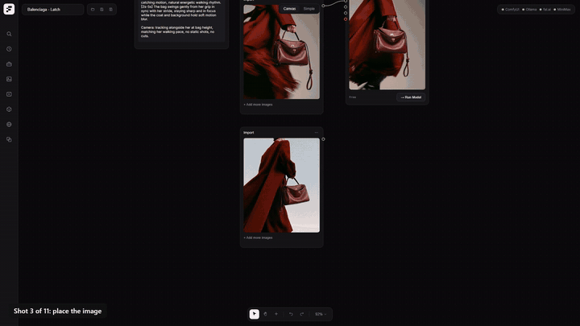

# freavy

A free, local-first node canvas for AI image and video generation, built on top of [ComfyUI](https://github.com/comfyanonymous/ComfyUI). A simpler alternative to Weavy: drag nodes onto one canvas, wire them together, and run everything on your own GPU. Any node can optionally switch to a fal.ai API model.

- **Canvas mode**: full node graph (prompt, generate, edit, upscale, video).
- **Simple mode**: Higgsfield-style composer plus feed.
- **Local engines**: ComfyUI (:8188) and Ollama (:11434). No account, nothing uploaded.
- **MCP server**: drive generation and canvases from Claude Code or any MCP client (`mcp/`).

Built by [Frame Department](https://framedepartment.co). MIT licensed.

[](docs/freavy-demo.mp4)
*Click for the full 54s demo: 11 stills animated locally with MiniMax H3, driven from Claude through the freavy MCP.*

## Fastest path

1. Install [Node.js](https://nodejs.org), [pnpm](https://pnpm.io) 12, [ComfyUI](https://github.com/comfyanonymous/ComfyUI) (Windows portable) and [Ollama](https://ollama.com).
2. `git clone https://github.com/FrameDeptCo/freavy.git`, then `pnpm install --frozen-lockfile` inside it.
3. Download the four **Qwen Image 2512** files listed in [setup/models.md](setup/models.md) into your ComfyUI `models` folders.
4. Start ComfyUI, then `pnpm --filter server dev` and `pnpm --filter client dev`.
5. Run `node scripts/smoke-test.mjs --generate`. It checks everything and renders one free local image.
6. Open http://localhost:5917, open `examples/hello-image.freavy.json` from the folder icon, and press Run Model.

Don't want to do it by hand? Give [AGENTS.md](AGENTS.md) to Claude Code or any coding agent and tell it "read AGENTS.md and get freavy running". It walks the agent through checks, install, models, verification and troubleshooting.

## Example canvases

In `examples/`, openable from the folder icon in the app:

- `hello-image.freavy.json`: a prompt into Qwen Image. The smallest working canvas.
- `image-to-video.freavy.json`: Qwen Image makes a still, MiniMax H3 animates it with a timeline prompt.

## What you need

freavy is the canvas and orchestrator. The generation itself happens in engines you run yourself, and the models are separate downloads (several GB to tens of GB each). Nothing works until those are in place.

- **Windows 11.** Developed and tested only there. The code is plain Node and should port, but Linux and macOS are untested.
- **Node.js** (tested on 24) and **[pnpm](https://pnpm.io) 12** (the repo pins 12.3.4).
- **[ComfyUI](https://github.com/comfyanonymous/ComfyUI)**, recent version (0.31+ recommended), running at `127.0.0.1:8188`. This is what runs the local image and video models.
- **[Ollama](https://ollama.com)** at `127.0.0.1:11434`, only for the prompt, describe and LLM nodes.
- **An NVIDIA GPU.** Tested on a 24 GB RTX 4090. The video models need roughly that much; see the hardware notes in [setup/models.md](setup/models.md).
- **Model files** in ComfyUI's `models` folders. The exact files per model, download links and a status table (what is tested, what is not) are in [setup/models.md](setup/models.md). Start with Qwen Image 2512 to confirm everything is wired up.
- **fal.ai key** (optional, paid) for the API model options. Local models never need it.

## Setup

```
git clone https://github.com/FrameDeptCo/freavy.git
cd freavy
pnpm install --frozen-lockfile
copy server\.env.example server\.env
```

Start ComfyUI and Ollama yourself (or see `COMFY_DIR` below), then in two terminals:

```
pnpm --filter server dev
pnpm --filter client dev
```

Or run `start-freavy.bat`. Open http://localhost:5917. The orchestrator server listens on :5918.

The three dots in the top right (ComfyUI, Ollama, fal.ai) show what the server can reach. A local model is usable once ComfyUI is green and its files are installed.

## Configuration

Set these as environment variables before starting the server, or put keys in `server/.env`.

| Variable | Purpose | Default |
|---|---|---|
| `FAL_KEY` | fal.ai API models (optional) | unset |
| `MINIMAX_API_KEY` | direct MiniMax API models (optional) | unset |
| `COMFY_URL` | where ComfyUI is running | `http://127.0.0.1:8188` |
| `OLLAMA_URL` | where Ollama is running | `http://127.0.0.1:11434` |
| `COMFY_DIR` | Windows portable ComfyUI root; if set, the server starts ComfyUI for you when it is not already running | unset (never autostarts ComfyUI) |
| `OLLAMA_MODELS` | custom Ollama model folder, used when freavy starts Ollama | Ollama's default |

## Use it from Claude (MCP)

With the server running, register the MCP server once (use the full path to your clone):

```
claude mcp add freavy -- node C:/path/to/freavy/mcp/server.mjs
```

Set `FREAVY_URL` if the server is not on `http://127.0.0.1:5918`. Claude can then check engine status, list models, generate images and video, and build or run whole canvases.

## Troubleshooting

- **ComfyUI dot is red.** ComfyUI is not reachable at `COMFY_URL`. Start it first.
- **A model is greyed out.** Its files are missing or named differently. Compare against [setup/models.md](setup/models.md); names must match exactly.
- **A video run never finishes or crawls.** Likely out of VRAM. Lower the resolution or duration.
- **In-app model download fails.** That feature needs `COMFY_DIR` and a hosted manifest that is not part of this repo. Download the files by hand instead.

## Layout

| Path | What |
|---|---|
| `client/` | Vite + React canvas UI |
| `server/` | Orchestrator: ComfyUI/Ollama/fal.ai providers, workflow templates |
| `shared/` | Model registry and shared types |
| `mcp/` | MCP server exposing generation tools |

Adding a model: add an entry in `shared/registry.ts` and a graph builder in `server/src/providers/comfyTemplates.ts`.

## License

[MIT](LICENSE)
